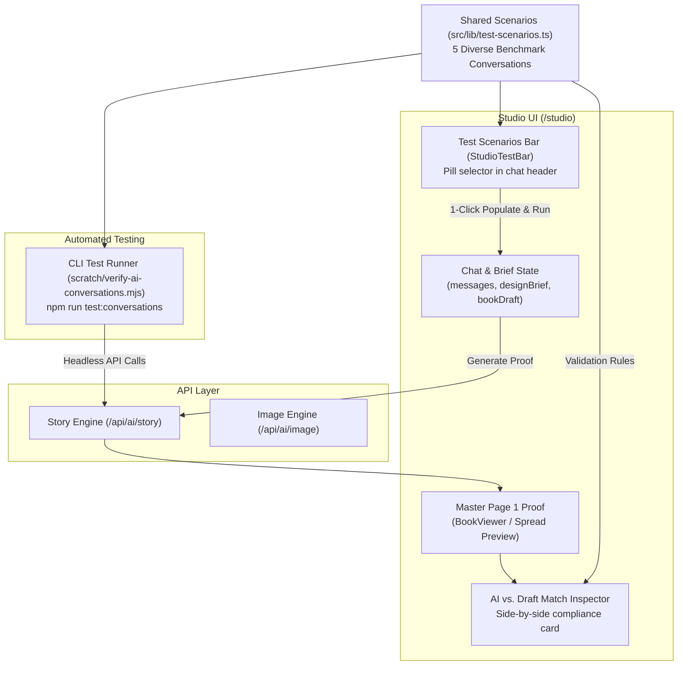

# Design Specification: Automated Conversation & Draft Verification Suite

**Date:** 2026-10-23  
**Status:** Approved  
**Target:** PaperTales AI Studio (`/studio`) & CLI Verification Suite

---

## 1. Problem Statement

Testing conversational book creation in `/studio` currently requires manually typing multi-turn dialogues back and forth across different genres (activity books, guided journals, coloring books, storybooks) to lock a design brief and inspect the generated Master Page 1 Proof. This manual process is time-consuming, prone to repetitive typing, and makes regression testing difficult when refining system prompts or formatting rules.

---

## 2. Goals & Success Criteria

1. **1-Click Studio Simulation:** Creators and developers can select any predefined benchmark conversation scenario directly inside `/studio` to automatically populate the dialogue, lock the brief, and generate Page 1 draft within seconds.
2. **Real-Time Brief Match Inspection:** The UI displays a live compliance card comparing the agreed consultation parameters (color vs. monochrome, trim size, layout structure, character anchor) directly against the properties of the generated Page 1 draft.
3. **Headless CLI Test Runner:** A standalone command (`npm run test:conversations`) executes the same conversation test suite headlessly against `/api/ai/story` and outputs a structured pass/fail report.
4. **Zero Regressions:** Preserves existing manual chat flexibility, token economics, and book expansion flows.

---

## 3. Architecture & Components



---

## 4. Shared Test Scenarios Matrix (`src/lib/test-scenarios.ts`)

The catalog contains 5 realistic, full-conversation scenarios covering all supported lanes:

```typescript
export interface ConversationTestScenario {
  id: string;
  name: string;
  icon: string;
  badge: string;
  description: string;
  brief: {
    title: string;
    genre: "coloring_book" | "storybook" | "memory_book" | "activity_book" | "math_book" | "science_book";
    trimSize: "8.5x8.5" | "6x9" | "8.5x11";
    interiorColor: "standard_color" | "black_and_white";
    artStyle: string;
    pageStructure: string;
    pageCount: number;
    character: {
      name: string;
      type: string;
      traits: string[];
    };
  };
  messages: Array<{ role: "user" | "assistant"; content: string }>;
  expectedMatches: {
    expectedTitle: string;
    expectedLayoutType?: "empty_lined" | "guided_sections" | "classic_prompt";
    expectedColorMode: "standard_color" | "black_and_white";
    expectedImagePromptKeywords: string[];
    forbiddenImagePromptKeywords?: string[];
    expectedTrimSize: string;
  };
}
```

### Benchmark Scenarios:
1. **Space Science Activity Book (`science_space_color`):**
   - *Brief:* Full color (`standard_color`), `8.5x11` workbook, alternating activity/fact, character Nova the Astronaut.
   - *Expected:* Vibrant full-color prompt keywords; zero coloring outline prefixes; trim `8.5x11`.
2. **15-Day Beginner Content Creation Journal (`journal_content_creation`):**
   - *Brief:* Black & white, `8.5x8.5` square, empty lined layout with small spot illustration, Day 1 title.
   - *Expected:* `layoutType === "empty_lined"`, `hasIllustration === true`, clean borders without chat sentences.
3. **Barnaby's Bakery Coloring Book (`coloring_barnaby_puppy`):**
   - *Brief:* Black & white vector line art, `8.5x8.5`, thick black outlines, Barnaby the puppy.
   - *Expected:* Strictly black and white line art ready for crayons, zero shading.
4. **Pixel Fox's Math & Logic Quest (`math_logic_quest`):**
   - *Brief:* Arithmetic and geometry puzzles, `8.5x11`, counting keys.
   - *Expected:* Counting/riddle page title, trim `8.5x11`.
5. **Generational Keepsake & Family Memoir (`memory_family_heirloom`):**
   - *Brief:* 6×9 trade format, warm personal reflection narrative.
   - *Expected:* Trim `6x9`, narrative tone preserved without coloring page constraints.

---

## 5. In-Studio UI Components (`src/app/studio/page.tsx`)

### 5.1 Test Scenarios Bar (`StudioTestBar`)
- Rendered in the studio header or chat pane.
- Shows clickable scenario pills with icons and genre badges.
- Includes a **"Reset to Blank"** button.
- Behavior on click:
  1. Sets `messages` state to the scenario's complete conversation.
  2. Sets `bookDraft` and `designBrief` with the agreed brief.
  3. Sets `discussionStage = "concept_locked"` and `isReadyForProof = true`.
  4. Automatically triggers `handleDesignHeroPage()` to draft Master Page 1.

### 5.2 AI vs. Draft Match Inspector Card (`DraftMatchInspector`)
- Displays directly below the generated Page 1 Master Proof.
- Performs automated compliance checks against `expectedMatches`:
  - 🎨 **Art Style & Color:** Verifies color keywords vs. line art keywords in `page.imagePrompt` according to `interiorColor`.
  - 📐 **Trim Size:** Verifies `book.format.trimSize` matches `brief.trimSize`.
  - 📑 **Layout & Structure:** Verifies `journalData.layoutType` or activity format.
  - 🏷️ **Title & Character:** Verifies title and character anchor consistency.
- Displays a prominent status pill:
  - `✅ 100% Brief Match (All 4 checks passed)` in emerald glacier glass.
  - `⚠️ Discrepancy Found (N/4 checks passed)` in amber glacier glass with a clickable breakdown.

---

## 6. Headless CLI Verification Runner (`scratch/verify-ai-conversations.mjs`)

- Can be executed via:
  ```bash
  npm run test:conversations
  ```
  or directly:
  ```bash
  node scratch/verify-ai-conversations.mjs
  ```
- Workflow:
  1. Iterates over all 5 scenarios sequentially.
  2. Submits payload to `/api/ai/story` (port 3000 by default, configurable via `PORT` or `BASE_URL`).
  3. Verifies API response success.
  4. Runs exact assertions matching `expectedMatches`.
  5. Prints a stylized ASCII table with pass/fail status and execution time per scenario.
  6. Exits with code `0` on 100% pass, or code `1` on failure.

---

## 7. Quality & Error Handling

- **Non-blocking:** Test scenarios run safely without interfering with real users' manual workflows.
- **Mock/Offline Safe:** Leverages existing template & Pollinations fallbacks when external API keys are omitted or rate-limited.
- **Strict Typing:** All scenarios, briefs, and match results are strictly typed with TypeScript.
